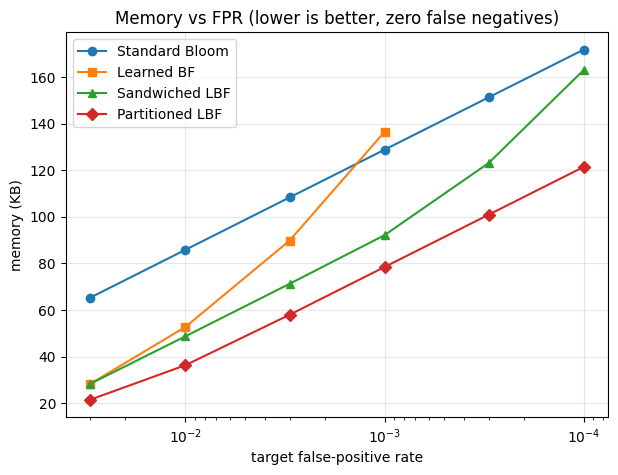

# Learned Bloom Filters for Memory-Efficient Set Membership

CS328 (Data Science) course project under Prof. Anirban Dasgupta, IIT Gandhinagar.

**Update, Nov 2026:** I'm now extending this to payments with Heet Panchal, as MuleSieve: screening
a payee against flagged mule accounts at payment time without exposing the list. Design note in
[`mulesieve/DESIGN.md`](mulesieve/DESIGN.md).

A Bloom filter is one of those data structures that feels like cheating: it tells you whether
something is in a set using a tiny fraction of the memory it would take to actually store the set,
and it never gives a false "no". The catch is it occasionally gives a false "yes". I kept reading
that you can make it even smaller by putting a small machine-learning model in front of it, and I
wanted to find out whether that actually holds up when you count the model's own size honestly,
or whether it's the kind of result that only looks good if you ignore the fine print.

So in this project I built a normal Bloom filter and three "learned" versions from scratch, ran them
on a real blocklist of malicious URLs, and measured who actually wins.

## Why bother (the problem)

Lots of systems need to answer "have I seen this before?" extremely fast and cheaply: is this URL
on the malware list, is this key in the database before I hit disk, is this username taken. Storing
the full set is expensive when you need it in RAM or on every device. A Bloom filter trades a little
accuracy for a lot of memory, and crucially it only errs in the safe direction here: it never lets
a known-bad URL through (no false negatives), it just sometimes raises a false alarm you can
double-check. The whole game is getting the false-alarm rate as low as possible for as few bits as
possible.

The bet behind a *learned* Bloom filter is that malicious URLs aren't random: they have patterns
(weird domains, tokens like `login`/`webscr`/`.php`, high-entropy gibberish). If a small model can
pick up on that, maybe it can shrink the filter further. But a model makes mistakes in both
directions, and a Bloom filter is not allowed to miss a real member, so you can't just swap one for
the other.

## How I approached it

The fix from the literature is: keep a small model (an "oracle") to guess membership, and back it
up with a small Bloom filter that stores only the members the model would have gotten wrong. That
restores the no-false-negative guarantee. I implemented the standard filter plus three designs that
arrange this idea differently:

- **Learned BF** (Kraska et al. 2018): oracle in front, one backup filter behind it.
- **Sandwiched LBF** (Mitzenmacher 2018): an extra filter *before* the oracle to cheaply kill
  obvious non-members first.
- **Partitioned LBF** (Vaidya et al. 2021): instead of one trust/distrust threshold, split the
  score range into bands and give each band its own backup, sized by a water-filling rule.

For the oracle I used logistic regression on 4,128 features (32 hand-built lexical ones like length,
entropy and suspicious-token counts, plus 4,096 hashed character n-grams). I went with logistic
regression on purpose: its size *is* its list of weights, so it's tiny (about 4 KB at int8) and easy
to count honestly. I checked XGBoost too, which was a bit more accurate but serialized to
122 KB–1.3 MB, bigger than the whole filter it was supposed to shrink, so it loses on net memory.
That trade-off is one of the things I wanted the project to show.

The comparison only means something if it's fair, so the oracle's 4 KB always counts against the
learned designs, benign URLs are split three ways (train the oracle / pick the operating point /
report the final false-positive rate) so the reported number is on URLs nothing ever tuned on, and
I build the actual filters at the end and query every member to confirm zero misses for real
instead of just trusting the math.

## Results

Set = 73,367 malicious URLs. Oracle AUC ≈ 0.97 at 4 KB. Memory (KB) for the same false-positive
rate, zero false negatives throughout:

| Target FPR | Standard BF | Learned BF | Sandwiched | Partitioned | best saving |
|---|---|---|---|---|---|
| 1%    | 85.8  | 52.7        | 48.7  | 36.3  | 57.7% |
| 0.1%  | 128.8 | 136.4       | 92.1  | 78.4  | 39.1% |
| 0.01% | 171.7 | infeasible  | 162.9 | 121.4 | 29.3% |



Partitioned LBF (red) is lowest everywhere and saves 29–67% over a standard filter. The plain
Learned BF (orange) is the interesting one: it's great at loose targets but actually gets *worse*
than a normal Bloom filter once you demand a very low false-positive rate, and below 0.03% there's
no valid configuration at all. That's not a bug, it's the known weakness of using a single
threshold, and it's exactly why the sandwiched and partitioned versions exist. Full tables are in
[`results/`](results/).

I also confirmed it actually works rather than just adding up on paper: building the real structure
at 0.1% gave 0 false negatives across all 73,367 members and a held-out false-positive rate of
0.0005, under the 0.001 target.

## Does the learning actually help, or is it the method?

To check that the savings come from real structure and not from the technique being clever, I reran
the whole thing on random made-up strings, where members and non-members are drawn from the same
distribution so there's genuinely nothing to learn. The oracle dropped to 0.54 AUC (basically a coin
flip) and the partitioned filter became 2–6% *worse* than a plain Bloom filter. So the gains are
coming from the structure in real URLs; strip that out and the model is just dead weight. This was
the experiment I trusted most, because it could have killed the result.

## Limitations

I'd rather state these up front than pretend they aren't there:

- Only one dataset. URLs have nice learnable structure; integer keys or dictionary words might not,
  and I haven't shown it generalizes.
- The set is static. Bloom filters don't support deletion, and the oracle is trained once, so a set
  that changes over time would need a rebuild or an online oracle.
- The oracle is linear. A character-level CNN/GRU (Kraska's original) would likely push AUC past
  0.98 and save more, at the cost of size and needing careful quantized size accounting.
- Build speed is plain Python and not optimized; the contribution here is the query logic and the
  comparison, not raw throughput.
- I measure average-case false-positive rate, not adversarial. Someone who knows the oracle could
  craft benign URLs that score high and inflate false alarms (it can't cause a false negative
  though, the backup prevents that).

## Running it

Everything is plain `numpy` + `scikit-learn`, no GPU. The notebooks are already executed so the
graphs and tables show up on GitHub directly, but you can rerun any of them top to bottom (they each
download the dataset themselves on first run):

1. Open a notebook in Jupyter or Colab.
2. Run all. Notebooks 03–05 train the oracle and take a minute or two; 01–02 are instant.
3. Read them in order 01 → 05 for the full story.

```
01_problem_and_data.ipynb       data download + a look at the dataset
02_standard_bloom_filter.ipynb  Bloom filter from scratch, empirical FPR vs theory
03_learned_oracle.ipynb         features, oracle training, AUC, score separation
04_learned_filters.ipynb        LBF / Sandwiched / PLBF + the real zero-FN/FPR check
05_results_and_ablation.ipynb   combined frontier + the random-key ablation
mulesieve/DESIGN.md             design note for the payments extension (in progress)
figures/  results/              exported plots and CSVs
```

`data/url_data.csv` (~11 MB) downloads automatically and is git-ignored.

## References

- Kraska et al., *The Case for Learned Index Structures*, SIGMOD 2018.
- Mitzenmacher, *A Model for Learned Bloom Filters and Optimizing by Sandwiching*, NeurIPS 2018.
- Vaidya et al., *Partitioned Learned Bloom Filters*, ICLR 2021.
